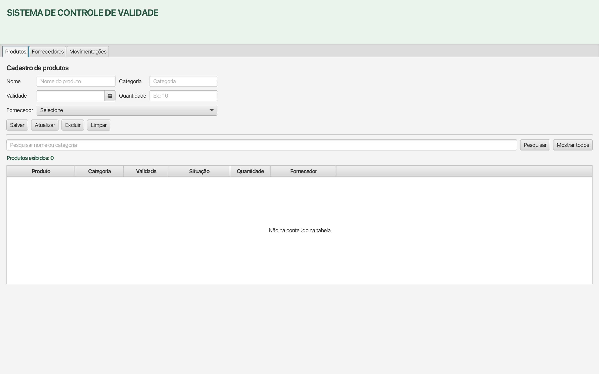
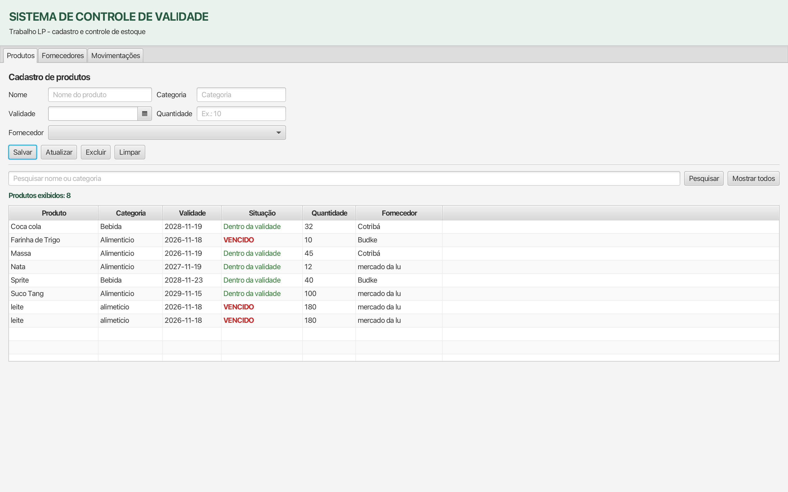
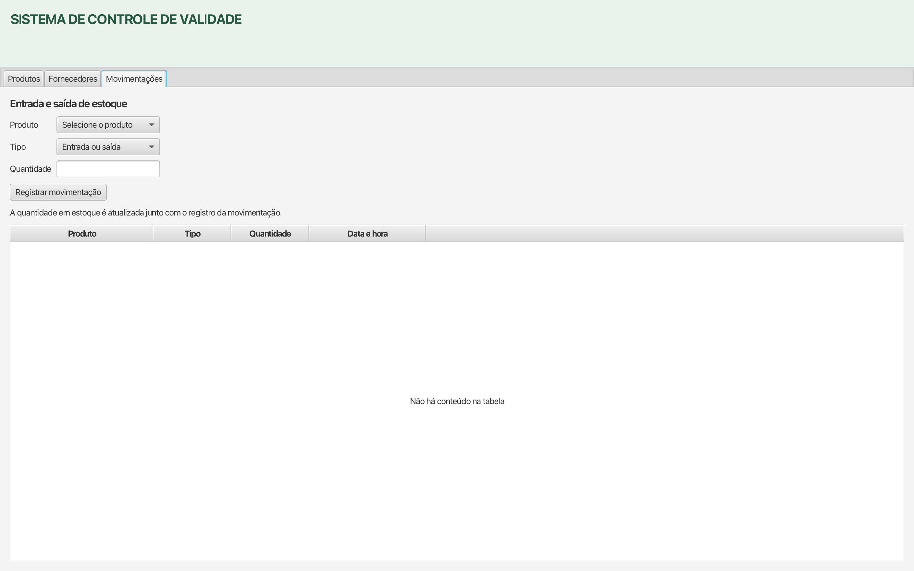
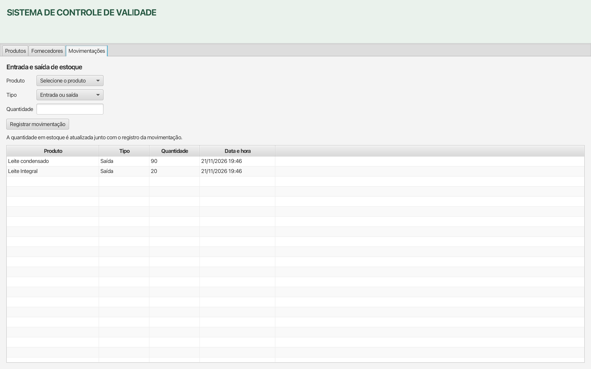
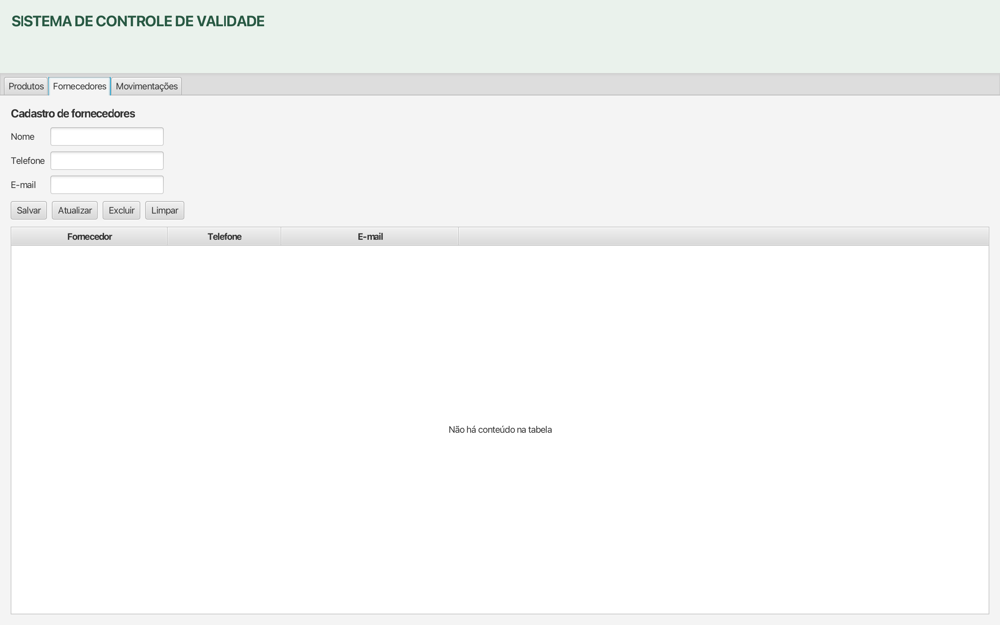
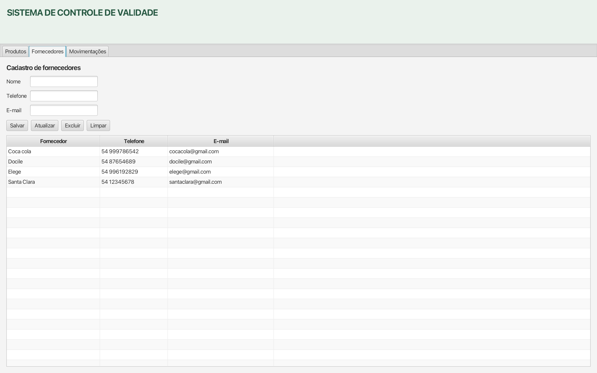

# Sistema de Controle de Validade 

## 1. Apresentação
Sistema de Controle de Validade é um programa desenvolvido para auxiliar no gerenciamento de produtos de um supermercado, facilitando o cadastro de fornecedores, o controle dos produtos e o acompanhamento das datas de validade.

O sistema foi desenvolvido como trabalho acadêmico da disciplina de Linguagem de Programação III, com o objetivo de colocar em prática os conhecimentos adquiridos durante as aulas.

## 2. Problema
Trabalho em um supermercado e, no dia a dia, percebo que temos uma dificuldade em relação ao controle das datas de validade dos produtos. Atualmente, não temos um controle suficientemente organizado que permita acompanhar essas datas de maneira eficiente, o que pode dificultar a identificação de produtos próximos do vencimento ou que já estejam vencidos.

A partir dessa situação, surgiu a ideia de desenvolver um sistema que pudesse ajudar a resolver esse problema. Acredito que implementar uma ferramenta desse tipo seria muito interessante, pois permitiria cadastrar os produtos, acompanhar suas datas de validade e controlar as quantidades em estoque, facilitando a organização e ajudando a evitar perdas de mercadorias. E também acho interessante a ideia de informar o fornecedor de tal produto, visto que em alguns casos é possível o forncedor fazer uma troca com os produtos vencidos ou até dar uma bonifiação referente ao valor ou quantidade de produtos vencidos, por isso a importância de saber de "onde veio" o produto.

## 3. Objetivo
Desenvolver uma aplicação que permita cadastrar e gerenciar fornecedores e produtos, acompanhar as datas de validade e registrar entradas e saídas de estoque, contribuindo para uma administração mais organizada e eficiente.

## 4. Funcionalidades
O sistema possui as seguintes funcionalidades:

- Cadastro de fornecedores;
- Edição e exclusão de fornecedores;
- Cadastro de produtos;
- Consulta, edição e exclusão de produtos;
- Associação dos produtos aos seus respectivos fornecedores;
- Registro do nome, categoria, quantidade e data de validade dos produtos;
- Identificação de produtos vencidos e produtos dentro da validade;
- Pesquisa de produtos por nome ou categoria;
- Registro de entradas e saídas de produtos;
- Atualização automática da quantidade em estoque após as movimentações;
- Registro do histórico de movimentações.

## 5. Tecnologias utilizadas
Para o desenvolvimento do projeto foram utilizadas as seguintes tecnologias e ferramentas:

- **Java 21:** linguagem de programação utilizada no desenvolvimento;
- **JavaFX:** criação da interface gráfica;
- **FXML:** estruturação das telas da aplicação;
- **Scene Builder:** ferramenta visual utilizada para auxiliar na criação das interfaces;
- **Maven:** gerenciamento das dependências do projeto;
- **JPA:** tecnologia utilizada para a persistência dos dados;
- **Hibernate:** implementação utilizada para o mapeamento e gerenciamento dos dados;
- **SQLite:** banco de dados utilizado para armazenar as informações.

## 6. Organização do projeto
O projeto foi organizado em pacotes, separando as responsabilidades de cada parte do sistema.

- **model:** contém as classes que representam as entidades Fornecedor, Produto e Movimentacao;
- **controller:** contém a classe responsável por controlar as ações realizadas na interface;
- **repository:** contém as classes responsáveis pelas operações de cadastro, consulta, atualização e exclusão dos dados;
- **persistencia:** contém a classe de apoio para a criação e obtenção do EntityManager;
- **resources:** contém os arquivos FXML e as configurações de persistência;
- **docs:** contém os arquivos e a imagem do diagrama de classes.

## 7. Banco de dados e entidades
O sistema utiliza o banco de dados SQLite, com persistência realizada por meio de JPA e Hibernate.

Foram desenvolvidas três entidades principais:

**Fornecedor:** armazena as informações dos fornecedores, como nome, telefone e e-mail.

**Produto:** armazena as informações dos produtos, como nome, categoria, data de validade e quantidade em estoque. Cada produto está associado a um fornecedor.

**Movimentacao:** registra as movimentações realizadas no estoque, armazenando o produto, o tipo de movimentação, a quantidade e a data e hora do registro.

As entidades possuem os seguintes relacionamentos:

- Um fornecedor pode estar associado a vários produtos;
- Cada produto está associado a um fornecedor;
- Um produto pode possuir várias movimentações;
- Cada movimentação está associada a um produto.

## 8. Diagrama de classes
O diagrama de classes apresenta a estrutura do sistema, suas principais classes, atributos e relacionamentos.

## 9. Como executar o projeto
Para executar o sistema, é necessário ter o JDK 21 e o NetBeans instalados.

Passos para execução:

1. Baixar ou clonar o repositório do projeto;
2. Abrir o NetBeans;
3. Selecionar a opção **File → Open Project**;
4. Localizar e selecionar a pasta do projeto;
5. Aguardar o Maven carregar as dependências necessárias;
6. Executar o projeto pelo NetBeans, utilizando a opção **Run Project** ou a tecla F6.

O banco de dados SQLite é utilizado para armazenar as informações cadastradas e as movimentações realizadas.

## 10. Imagens do sistema
A seguir, são apresentadas algumas telas do Sistema de Controle de Validade, demonstrando suas principais funcionalidades.

### Tela principal

### Cadastro de produtos

### Movimentações de estoque

### Cadastro de fornecedores

## 11. Vídeo de apresentação
O vídeo apresenta o funcionamento do sistema e demonstra suas principais funcionalidades.

**Link do vídeo:** [Assistir à apresentação](https://youtu.be/czE9lZU8d44?feature=shared)

## 12. Repositório
**GitHub:** [Adicionar link do repositório]

---

**Instituição:** IFRS – Campus Ibirubá

**Disciplina:** Linguagem de Programação III

**Professor:** Roger Lavanda

**Integrante(s):** Amanda Stohlirck